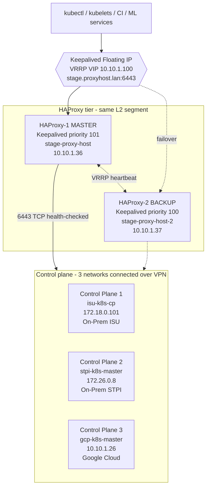
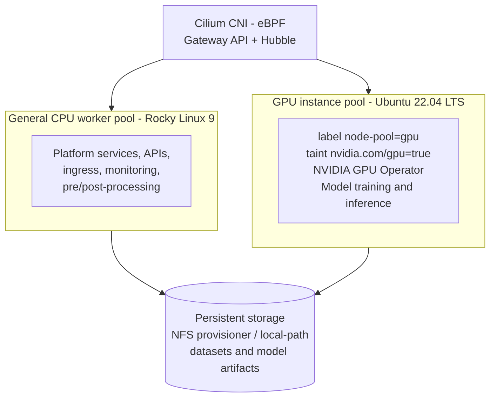
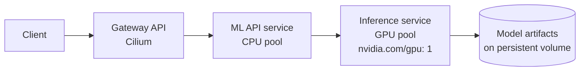

<div align="center">

</div>
<p align="center">
<a href="https://kubernetes.io/"></a>
<a href="https://rockylinux.org/"></a>
<a href="https://ubuntu.com/"></a>
<a href="https://cilium.io/"></a>
<a href="https://helm.sh/"></a>
<a href="https://www.haproxy.org/"></a>
<a href="https://www.keepalived.org/"></a>
<a href="https://etcd.io/"></a>
<a href="https://cri-o.io/"></a>
<a href="https://github.com/NVIDIA/gpu-operator"></a>
<a href="https://kubernetes.io/docs/concepts/storage/"></a>
</p>
<blockquote>
<p align="center"><b>End-to-end automation for a production-grade, highly available Kubernetes cluster that spans multiple regions, public cloud providers, and bank private on-prem networks. A Keepalived floating IP serves as the stable control plane endpoint, running between two HAProxy load balancers for failover. The setup covers etcd quorum management, persistent storage, and RBAC.</b></p>
<p align="center"><b>Dedicated GPU instance pools support ML application deployments, all designed for security and compliance in regulated hybrid enterprise environments.</b></p>
</blockquote>
 
## 📌 What This Project Solves
 
Managing a **highly available Kubernetes cluster across multiple networks, regions, and cloud providers** is one of the hardest real-world infrastructure challenges. This repo documents and scripts the entire lifecycle, from bootstrapping nodes to recovering a broken etcd quorum, with production-grade tooling.
 
It also removes the usual single point of failure in front of the API server: the control plane endpoint is a **Keepalived floating IP** that moves between **two HAProxy nodes**, so losing a load balancer never takes down `kubectl`, kubelets, or ML workloads. **GPU instance pools** join as dedicated worker pools so ML applications run on the right hardware.
 
---
 
## 🖥️ Cluster Inventory and Operating Systems
 
| Role | Hostname | IP address | Network / Site | OS |
|---|---|---|---|---|
| Floating IP (VIP) | `stage.proxyhost.lan` | `10.10.1.100` | Proxy subnet | Keepalived VIP |
| HAProxy-1 (MASTER) | `stage-proxy-host` | `10.10.1.36` | Proxy subnet | Rocky Linux 9.x |
| HAProxy-2 (BACKUP) | `stage-proxy-host-2` | `10.10.1.37` | Proxy subnet | Rocky Linux 9.x |
| Control plane 1 | `isu-k8s-cp` | `172.18.0.101` | On-prem (ISU) | Rocky Linux 9.x |
| Control plane 2 | `stpi-k8s-master` | `172.26.0.8` | On-prem (STPI) | Rocky Linux 9.x |
| Control plane 3 | `gcp-k8s-master` | `10.10.1.26` | Google Cloud | Rocky Linux 9.x |
| CPU workers | `<site>-k8s-wk-<n>` | `<worker-ip>` | Any site | Rocky Linux 9.x |
| **GPU workers** | `gpu-k8s-wk-<n>` | `<gpu-ip>` | Any site / cloud | **Ubuntu 22.04 LTS** |
 
This is a mixed-OS cluster. Kubernetes and Cilium behave the same on both, and each role uses the OS that suits it best. Rocky Linux can run NVIDIA GPUs through the RHEL 9 driver repositories, but the NVIDIA GPU Operator's driver container does not officially target Rocky, so GPU nodes use Ubuntu LTS.
 
> The DNS name `stage.proxyhost.lan` always points to the **floating IP**, never to an individual HAProxy node. Replace the IPs, hostnames and the `eth0` interface name with your own values.
 
---
 
## 🏗️ Architecture Overview
 
### Control plane and load balancing
 

 
> ⚡ All control planes are on **different networks**, connected via **VPN**, making this a true cross-network, hybrid HA setup. etcd quorum runs across the VPN. The two HAProxy nodes sit in the same L2 segment so the floating IP can move between them.
 
### Worker pools for ML applications
 

 
### ML application traffic flow
 

 
### Failover behaviour
 
| Failure | What happens | Impact |
|---|---|---|
| HAProxy-1 (MASTER) goes down | Keepalived on HAProxy-2 stops receiving VRRP advertisements and takes over the floating IP | API stays reachable on the same IP, no kubeconfig changes |
| HAProxy process crashes on MASTER | Keepalived health check fails, priority drops, floating IP moves to BACKUP | Automatic failover even if the host stays up |
| One control plane goes down | HAProxy health checks remove it from the backend pool, etcd keeps quorum (2 of 3) | Cluster keeps serving |
| MASTER recovers | Higher priority reclaims the floating IP | Automatic failback |
| GPU node goes down | Pods are rescheduled onto remaining GPU nodes if capacity exists | ML workloads keep running at reduced capacity |
 
---
 
## ✨ Key Features
 
| Feature | Detail |
|---|---|
| 🌐 **Multi-Region Control Plane** | 3 control planes across on-prem (ISU, STPI) and GCP, connected over VPN |
| 🎯 **Keepalived Floating IP** | VRRP-managed virtual IP used as the `--control-plane-endpoint`, so the API address never changes during failover |
| ⚖️ **Dual HAProxy Load Balancing** | Two HAProxy nodes (MASTER/BACKUP), TCP-mode round-robin with health checks on all API servers |
| 🧠 **etcd Quorum Management** | Handles cross-network etcd peer certs (SANs), stale member removal, clean rejoin |
| 🔒 **RBAC Automation** | Scripts for Linux user creation, Kubernetes user binding, and kubeconfig distribution |
| 📦 **Persistent Storage** | Supports both NFS (`nfs-subdir-external-provisioner`) and local-path provisioner |
| 🎮 **GPU Instance Pools** | Dedicated, labelled and tainted Ubuntu GPU worker pools with the NVIDIA GPU Operator for ML applications |
| 🌿 **Cilium CNI** | eBPF-powered networking with kube-proxy replacement, Hubble observability, Gateway API |
| 🔁 **Full Recovery Playbooks** | Step-by-step recovery for etcd split-brain, hostname-change, floating IP and GPU failures |
| 📖 **Production Reference Guide** | Complete manual setup guide with real commands, real errors, and real fixes |
 
---
 
## 📁 Repository Structure
 
```
MLOps-Kubernetes/
├── hybrid-multi-region-ha-cluster-setup.txt  # 📖 Complete manual setup reference guide
├── slave-nodes.sh                            # 👷 Worker node join helper script
├── RBAC-Kubernetes/
│   ├── create-linux-user.sh                  # 👤 Create OS-level user on node
│   ├── create-k8s-user.sh                    # 🔑 K8s user with cert-based auth + role binding
│   ├── move-kubeconfig.sh                    # 📤 Distribute kubeconfig to user
│   └── steps-to-execute.txt                  # 📋 RBAC execution order guide
├── LICENSE                                   # ⚖️ MIT license
└── README.md
```
 
---
 
## 🛠️ Setup Guide
 
The full step-by-step manual setup is documented in **`hybrid-multi-region-ha-cluster-setup.txt`**.
 
Below is a high-level summary of the setup phases. IPs, interface names and hostnames are examples, so replace them with your own. `stage.proxyhost.lan` is the DNS name (or `/etc/hosts` entry) that resolves to the **Keepalived floating IP**.
 
### Phase 1 — HAProxy Nodes (run on both)
 
```bash
dnf install haproxy keepalived -y
cp /etc/haproxy/haproxy.cfg /etc/haproxy/haproxy.cfg-original
 
# Allow API traffic and VRRP between the two HAProxy nodes
firewall-cmd --permanent --add-port=6443/tcp
firewall-cmd --permanent --add-rich-rule='rule protocol value="vrrp" accept'
firewall-cmd --reload
 
# Add DNS / /etc/hosts entry: stage.proxyhost.lan -> 10.10.1.100 (floating IP)
echo "10.10.1.100 stage.proxyhost.lan" >> /etc/hosts
```
 
Edit `/etc/haproxy/haproxy.cfg`. It is **identical on both nodes** (keep the stock `global` section):
 
```
defaults
    mode                    tcp
    log                     global
    option                  tcplog
    option                  dontlognull
    retries                 3
    timeout connect         10s
    timeout client          1h
    timeout server          1h
    timeout check           10s
    maxconn                 3000
 
frontend k8s-api
    bind *:6443
    mode                tcp
    option              tcplog
    default_backend     k8s-control-planes
 
backend k8s-control-planes
    mode        tcp
    option      tcp-check
    balance     roundrobin
    default-server inter 10s downinter 5s rise 2 fall 2 slowstart 60s maxconn 250 maxqueue 256 weight 100
    server isu-k8s-cp      172.18.0.101:6443 check
    server stpi-k8s-master 172.26.0.8:6443   check
    server gcp-k8s-master  10.10.1.26:6443   check
```
 
```bash
haproxy -c -V -f /etc/haproxy/haproxy.cfg     # validate config
systemctl enable --now haproxy.service
```
 
> The 1h client/server timeouts keep long-lived `kubectl` sessions (`watch`, `logs -f`, `exec`) from being cut by the proxy.
 
### Phase 2 — Keepalived Floating IP (run on both)
 
`/etc/keepalived/keepalived.conf` on **HAProxy-1 (MASTER)**:
 
```
vrrp_script chk_haproxy {
    script "/usr/bin/systemctl is-active --quiet haproxy"
    interval 2
    weight -20
    fall 2
    rise 2
}
 
vrrp_instance K8S_API_VIP {
    state MASTER
    interface eth0
    virtual_router_id 51
    priority 101
    advert_int 1
 
    # Unicast VRRP works where multicast is blocked
    unicast_src_ip 10.10.1.36
    unicast_peer {
        10.10.1.37
    }
 
    virtual_ipaddress {
        10.10.1.100/24
    }
 
    track_script {
        chk_haproxy
    }
}
```
 
On **HAProxy-2 (BACKUP)** use the same file with `state BACKUP`, `priority 100`, `unicast_src_ip 10.10.1.37` and `unicast_peer` set to `10.10.1.36`.
 
```bash
systemctl enable --now keepalived
ip addr show eth0 | grep 10.10.1.100     # floating IP should appear on the MASTER only
```
 
Test failover by stopping HAProxy on the MASTER, confirming the floating IP appears on the BACKUP while `nc -zv stage.proxyhost.lan 6443` still succeeds, then starting HAProxy again to watch the IP fail back.
 
### Phase 3 — Prerequisites on All Cluster Nodes
 
**Rocky Linux 9 nodes (control planes, CPU workers):**
 
```bash
# Set hostname (final name, do not change later) and /etc/hosts:
#   10.10.1.100 stage.proxyhost.lan   (control planes also list the other control planes)
# Disable swap, set SELinux to permissive
# Open firewall ports: 6443, 2379-2380, 10250, 10257, 10259 (control plane),
#   10250 and 30000-32767 (workers), 8472/udp, 4240, 4244 (Cilium)
# Load kernel modules: overlay, br_netfilter
# Apply sysctl params: bridge-nf-call-iptables/ip6tables = 1, ip_forward = 1
 
KUBERNETES_VERSION=v1.32
PROJECT_PATH=stable:/v1.32
# Create the kubernetes.repo and cri-o.repo files (see the setup guide), then:
dnf install -y container-selinux cri-o
systemctl enable --now crio
dnf install -y kubelet kubeadm kubectl --disableexcludes=kubernetes
systemctl enable --now kubelet
```
 
**Ubuntu 22.04 LTS nodes (GPU workers):**
 
```bash
# Set hostname and /etc/hosts (10.10.1.100 stage.proxyhost.lan)
swapoff -a && sed -i '/ swap / s/^/#/' /etc/fstab
 
# Load kernel modules and sysctl params (same as Rocky)
modprobe overlay && modprobe br_netfilter
cat <<EOF | tee /etc/sysctl.d/k8s.conf
net.bridge.bridge-nf-call-iptables  = 1
net.bridge.bridge-nf-call-ip6tables = 1
net.ipv4.ip_forward                 = 1
EOF
sysctl --system
 
# Kubernetes packages (match the cluster minor version)
apt-get update && apt-get install -y apt-transport-https ca-certificates curl gpg
mkdir -p -m 755 /etc/apt/keyrings
curl -fsSL https://pkgs.k8s.io/core:/stable:/v1.32/deb/Release.key \
  | gpg --dearmor -o /etc/apt/keyrings/kubernetes-apt-keyring.gpg
echo 'deb [signed-by=/etc/apt/keyrings/kubernetes-apt-keyring.gpg] https://pkgs.k8s.io/core:/stable:/v1.32/deb/ /' \
  | tee /etc/apt/sources.list.d/kubernetes.list
apt-get update && apt-get install -y kubelet kubeadm kubectl
apt-mark hold kubelet kubeadm kubectl
 
# Install CRI-O for the same minor version (see https://cri-o.io), then:
systemctl enable --now crio kubelet
```
 
### Phase 4 — Initialize First Control-Plane
 
The control plane endpoint points at the **Keepalived floating IP** (via its DNS name), not at an individual HAProxy node. Each control plane still uses its own node IP as the API server advertise address.
 
```bash
sudo kubeadm init \
  --skip-phases=addon/kube-proxy \
  --control-plane-endpoint "stage.proxyhost.lan:6443" \
  --apiserver-cert-extra-sans "10.10.1.100,stage.proxyhost.lan" \
  --upload-certs
```
 
> Save the join output. **Never commit real tokens, discovery hashes or certificate keys to a public repository.**
 
### Phase 5 — Join Additional Control-Planes & Workers
 
```bash
# Control-plane join (stpi-k8s-master, gcp-k8s-master)
kubeadm join stage.proxyhost.lan:6443 \
  --token <token> \
  --discovery-token-ca-cert-hash sha256:<hash> \
  --control-plane \
  --certificate-key <cert-key>
 
# Worker node join (CPU and GPU pools)
kubeadm join stage.proxyhost.lan:6443 \
  --token <token> \
  --discovery-token-ca-cert-hash sha256:<hash>
```
 
**Cross-network etcd SANs (before joining the 3rd control plane):** back up the etcd PKI, then add the control-plane IPs to the etcd SAN lists by editing the existing ConfigMap in place (do not replace it with a partial file):
 
```bash
sudo cp -r /etc/kubernetes/pki/etcd /etc/kubernetes/pki/etcd.backup.$(date +%Y%m%d)
kubectl -n kube-system edit cm kubeadm-config
```
 
```yaml
etcd:
  local:
    serverCertSANs: ["localhost", "127.0.0.1", "172.18.0.101", "172.26.0.8", "10.10.1.26"]
    peerCertSANs:   ["localhost", "127.0.0.1", "172.18.0.101", "172.26.0.8", "10.10.1.26"]
```
 
### Phase 6 — Cilium CNI
 
```bash
helm repo add cilium https://helm.cilium.io/
helm install cilium cilium/cilium --version 1.18.5 \
  --namespace kube-system \
  --set kubeProxyReplacement=true \
  --set k8sServiceHost=stage.proxyhost.lan \
  --set k8sServicePort=6443 \
  --set hubble.relay.enabled=true
```
 
> **Gateway API:** install the Gateway API CRDs first, then add `--set gatewayAPI.enabled=true`.
 
### Phase 7 — Persistent Storage
 
```bash
# Local path provisioner
kubectl apply -f https://raw.githubusercontent.com/rancher/local-path-provisioner/master/deploy/local-path-storage.yaml
 
# OR NFS provisioner via Helm
helm install nfs-provisioner nfs-subdir-external-provisioner/nfs-subdir-external-provisioner \
  --set nfs.server=<NFS_SERVER_IP> \
  --set nfs.path=/nas \
  --set storageClass.name=stage-storage
```
 
### Phase 8 — GPU Instance Pools for ML Applications
 
Join the Ubuntu GPU instances as normal workers (Phases 3 and 5), then label and taint them so only GPU workloads land there.
 
```bash
# Label and taint the GPU nodes
kubectl label node <gpu-node> node-pool=gpu
kubectl taint node <gpu-node> nvidia.com/gpu=true:NoSchedule
 
# Install the NVIDIA GPU Operator (driver, container toolkit, device plugin)
helm repo add nvidia https://helm.ngc.nvidia.com/nvidia && helm repo update
helm install gpu-operator nvidia/gpu-operator \
  --namespace gpu-operator --create-namespace
 
# Verify GPUs are advertised
kubectl describe node <gpu-node> | grep -i "nvidia.com/gpu"
```
 
> **Using a driver already installed on the host?** Add `--set driver.enabled=false` so the operator skips its driver container. Check the NVIDIA GPU Operator docs for your version regarding CRI-O container toolkit settings, since the flags change between releases.
 
Example ML deployment pinned to the GPU pool:
 
```yaml
apiVersion: apps/v1
kind: Deployment
metadata:
  name: ml-inference
spec:
  replicas: 2
  selector:
    matchLabels:
      app: ml-inference
  template:
    metadata:
      labels:
        app: ml-inference
    spec:
      nodeSelector:
        node-pool: gpu
      tolerations:
        - key: nvidia.com/gpu
          operator: Exists
          effect: NoSchedule
      containers:
        - name: model-server
          image: <your-registry>/ml-inference:latest
          resources:
            limits:
              nvidia.com/gpu: 1
```
 
> 📖 For complete commands, configs, and troubleshooting, refer to **`hybrid-multi-region-ha-cluster-setup.txt`**
 
---
 
## 🔒 RBAC — Kubernetes User Management
 
The `RBAC-Kubernetes/` module handles the full lifecycle of granting a developer or operator scoped cluster access.
 
```bash
# Step 1 — Create Linux user on the node
bash RBAC-Kubernetes/create-linux-user.sh <username>
 
# Step 2 — Create K8s user with certificate-based auth + role binding
bash RBAC-Kubernetes/create-k8s-user.sh <username> <namespace> <role>
 
# Step 3 — Deliver kubeconfig to the user
bash RBAC-Kubernetes/move-kubeconfig.sh <username>
```
 
> See `RBAC-Kubernetes/steps-to-execute.txt` for the full execution order and examples.
 
---
 
## 🔁 Failure Recovery Playbooks
 
### Case 1 — Stale etcd Member (Control-Plane Rejoin)
 
> When a control-plane is rebuilt or re-provisioned, the old etcd membership blocks the rejoin with `error: etcd cluster is not healthy`. Wiping `/var/lib/etcd` on the broken node is not enough, the stale member must be removed from the cluster.
 
**Warning:** with 3 members you can lose 1 and keep quorum (2 of 3). Do not run this if 2 members are down, that needs a snapshot restore.
 
```bash
# Step 1 — On a healthy CP (stpi-k8s-master or gcp-k8s-master), list etcd members
kubectl -n kube-system exec -it etcd-stpi-k8s-master -- \
  etcdctl --endpoints=https://127.0.0.1:2379 \
  --cacert=/etc/kubernetes/pki/etcd/ca.crt \
  --cert=/etc/kubernetes/pki/etcd/healthcheck-client.crt \
  --key=/etc/kubernetes/pki/etcd/healthcheck-client.key \
  member list
 
# Step 2 — Remove the stale member using its hex ID, then delete the old node object
etcdctl ... member remove <STALE_MEMBER_HEX_ID>
kubectl delete node isu-k8s-cp
 
# Step 3 — On the broken node, clean state
kubeadm reset -f
systemctl stop kubelet
rm -rf /etc/kubernetes /var/lib/etcd /var/lib/kubelet /etc/cni/net.d
systemctl restart crio
 
# Step 4 — Generate a fresh token and certificate key on a healthy CP
kubeadm token create --print-join-command
kubeadm init phase upload-certs --upload-certs
 
# Step 5 — Rejoin the control plane
kubeadm join stage.proxyhost.lan:6443 --token <token> \
  --discovery-token-ca-cert-hash sha256:<hash> \
  --control-plane --certificate-key <cert-key>
```
 
### Case 2 — Hostname Changed on a Node

> Kubelet fails with `node "old-name" not found` after a hostname change, because the kubelet credentials still belong to the old node name.
 
```bash
# Stop services and clean state
systemctl stop kubelet && systemctl stop crio
rm -rf /etc/kubernetes /var/lib/etcd /var/lib/kubelet
 
# Update /etc/hosts with the new hostname and the floating IP entry
# Then, on a healthy CP, remove the old node and create a fresh join command
kubectl delete node <old-hostname>
kubeadm token create --print-join-command
 
# Restart the runtime and rejoin with the new hostname
systemctl start crio
bash slave-nodes.sh
```
 
### Case 3 — Floating IP Not Failing Over
 
> The VIP stays on a dead node, or appears on both HAProxy nodes (split-brain).
 
```bash
# Which node holds the VIP?
ip addr show eth0 | grep 10.10.1.100
 
# Check Keepalived and HAProxy state on both nodes
systemctl status keepalived haproxy
journalctl -u keepalived --since "10 min ago"
```
 
Common causes to verify:
- VRRP (protocol 112) blocked by firewalld or a network ACL between the two HAProxy nodes
- Different `virtual_router_id` on the two nodes, or wrong `unicast_src_ip` / `unicast_peer`
- HAProxy nodes not in the same L2 segment
- HAProxy not running on the MASTER, so the health check keeps lowering its priority

- ### Case 4 — GPU Not Detected on a Node
 
```bash
# Check GPU Operator pods on the node
kubectl -n gpu-operator get pods -o wide | grep <gpu-node>
 
# Confirm the driver sees the GPU (run on the GPU node)
nvidia-smi
 
# Confirm Kubernetes advertises it
kubectl describe node <gpu-node> | grep -A2 "nvidia.com/gpu"
```
 
Common causes to verify:
- Node is missing the `node-pool=gpu` label, or GPU workloads lack the matching toleration
- Kernel headers missing or Secure Boot blocking the NVIDIA driver on the Ubuntu node
- Driver installed on the host **and** operator-managed driver enabled at the same time (set `driver.enabled=false` if the host provides the driver)
- Container toolkit not configured for CRI-O on that node
---
 
## 📐 Design Decisions
 
**Why HAProxy over a cloud LB?**<br/>
This cluster spans on-prem and cloud nodes, so a cloud-native LB can't front all three control planes. HAProxy runs on dedicated proxy nodes with VPN access to all control-planes, making it the only viable cross-network solution.
 
**Why two HAProxy nodes with a Keepalived floating IP?**<br/>
A single HAProxy node would simply move the single point of failure from the API servers to the load balancer. Keepalived (VRRP) keeps one stable IP as the control plane endpoint and moves it to the BACKUP node automatically, so kubeconfigs, kubelets, and certificates never need to change during a failover.

**Why Cilium over flannel/calico?**<br/>
Cilium replaces kube-proxy entirely using eBPF, delivering better performance and built-in observability via Hubble, which is essential for cross-region traffic visibility.
 
**Why CRI-O over containerd/Docker?**<br/>
CRI-O is purpose-built for Kubernetes, lighter weight, and better aligned with OCI standards, reducing attack surface in compliance-sensitive environments.
 
**Why Ubuntu for GPU nodes while the rest stay on Rocky Linux?**<br/>
NVIDIA's drivers, container toolkit and GPU Operator target Ubuntu LTS first, so GPU nodes get the smoothest and best-documented path. Kubernetes doesn't care about the OS family, so the control plane and CPU workers keep the Rocky Linux compliance baseline.
 
**Why dedicated, tainted GPU pools?**<br/>
GPU instances are expensive. Labelling and tainting them keeps general workloads off GPU nodes, so capacity is reserved for ML training and inference and scheduling stays predictable.
 
---
 
## 🔐 Security Notes
 
- Never commit real join tokens, discovery hashes, certificate keys or kubeconfig files. Use placeholders in documentation and rotate anything that was exposed.
- Join tokens expire after 24 hours and the uploaded certificate key after 2 hours, so generate fresh ones when needed.
- Restrict VRRP and API server traffic (`6443`, `2379-2380`) to the proxy and node networks, and keep the VPN ACLs between sites as tight as possible.
  
---

## 📄 License
 
Released under the [MIT License](LICENSE).
 
---
 
## 💬 Connect
 
<p align="center">
📧 <b>Email:</b> <a href="mailto:sandeepdashdevops@gmail.com">sandeepdashdevops@gmail.com</a>
&nbsp;&nbsp;|&nbsp;&nbsp;
💻 <b>GitHub:</b> <a href="https://github.com/sandeepdash-mlops">github.com/sandeepdash-mlops</a>
</p>
---
 
<div align="center">

<br/>
<em>Real infrastructure. Real problems. Real fixes.</em>
</div>
