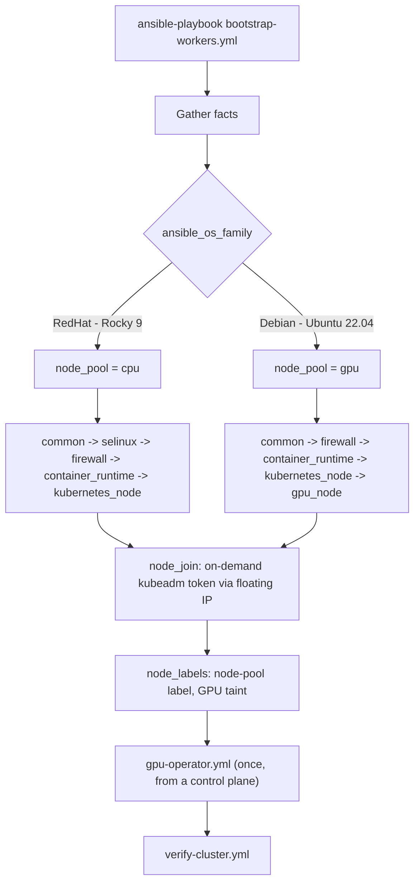

# Ansible: Hybrid HA Kubernetes Worker Automation

One playbook bootstraps **every** worker node. The **OS family** decides the profile:

| `ansible_os_family` | Distro | Profile | What runs |
|---|---|---|---|
| `RedHat` | Rocky Linux 9.x | **cpu** worker | SELinux, firewalld, dnf repos, CRI-O, kubelet, join, label |
| `Debian` | Ubuntu 22.04 LTS | **gpu** worker | ufw, apt repos, CRI-O, kubelet, **nouveau blacklist, optional host driver + NVIDIA toolkit**, join, label + taint |

This replaces the old `slave-nodes.sh` (Rocky only) and a separate GPU script. One inventory, one source of truth.



## Layout

```
ansible/
├── ansible.cfg
├── requirements.yml              # ansible.posix, community.general, kubernetes.core
├── Makefile                      # make check | bootstrap | operator | verify
├── inventory/
│   ├── hosts.yml                 # control_plane + workers (no cpu/gpu groups needed)
│   └── group_vars/
│       ├── all.yml               # VIP, DNS, k8s version, node_pool switch, GPU mode
│       └── workers.yml           # firewall + GPU reboot options
├── playbooks/
│   ├── site.yml                  # bootstrap -> operator -> verify
│   ├── bootstrap-workers.yml     # the single worker playbook
│   ├── gpu-operator.yml          # Helm install of NVIDIA GPU Operator
│   └── verify-cluster.yml        # nodes Ready, GPU capacity advertised
└── roles/
    ├── common/                   # hostname, /etc/hosts, swap, modules, sysctl
    ├── selinux/                  # RedHat only
    ├── firewall/                 # redhat.yml (firewalld) / debian.yml (ufw)
    ├── container_runtime/        # CRI-O, redhat.yml / debian.yml, handler: Restart crio
    ├── kubernetes_node/          # kubelet/kubeadm/kubectl, redhat.yml / debian.yml
    ├── gpu_node/                 # Ubuntu only: nouveau, host driver + toolkit
    ├── node_join/                # on-demand token, idempotent kubeadm join
    ├── node_labels/              # node-pool label + GPU taint (delegated to a control plane)
    └── gpu_operator/             # helm install gpu-operator
```

## Quick start

```bash
cd ansible
make deps                      # install collections
$EDITOR inventory/hosts.yml    # set ansible_user and worker IPs
make ping
make check                     # yamllint + ansible-lint + syntax

make bootstrap                              # all workers
make bootstrap LIMIT=gpu-k8s-wk-1           # one node
make bootstrap TAGS=gpu                     # only the GPU role
make operator                               # after GPU workers joined
make verify
# or everything: make site
```

Roll out in batches: `ansible-playbook playbooks/bootstrap-workers.yml -e bootstrap_batch_size=2`.

## Key variables

| Variable | Default | Meaning |
|---|---|---|
| `k8s_version` | `1.32` | Kubernetes **and** CRI-O minor version |
| `cluster_api_vip` / `cluster_api_dns` | `10.10.1.100` / `stage.proxyhost.lan` | Keepalived floating IP and its DNS name |
| `node_pool` | derived from OS family | `cpu` (RedHat) or `gpu` (Debian); override per host if needed |
| `gpu_driver_mode` | `operator` | `operator`: GPU Operator installs driver + toolkit. `host`: `gpu_node` installs them, operator runs without |
| `gpu_node_reboot_if_needed` | `false` | Auto-reboot when nouveau is loaded or a driver was just installed |
| `firewall_enable_ufw` | `false` | Enable ufw on Ubuntu (SSH is always allowed first) |
| `gpu_operator_chart_version` | empty | Pin the chart version for reproducible installs |

## Design decisions

- **Dispatch by OS family inside roles.** Roles use `include_tasks: "{{ ansible_os_family | lower }}.yml"`, so each role has one `redhat.yml` and one `debian.yml`. Adding another family is one new file.
- **Handlers + `flush_handlers`.** CRI-O and systemd changes are applied before the join step, not at the end of the play.
- **No secrets in Git.** `node_join` creates a short-lived `kubeadm` token on a control plane at run time and uses it immediately, with `no_log`. Nothing sensitive is stored in the repo.
- **Idempotent.** Re-running is safe. Joined nodes are detected via `/etc/kubernetes/kubelet.conf`, labels and taints are only changed when needed.
- **Safety guards.** The play refuses to rename an already-joined node (Failure Case 2), asserts the installed kubeadm matches `k8s_version`, and fails if a "GPU" node has no NVIDIA device.
- **Floating IP everywhere.** Workers join through `stage.proxyhost.lan` (the Keepalived VIP), never one HAProxy node.
- **CI.** `yamllint`, `ansible-lint` (production profile) and a syntax check run on every push.

## Prerequisites

- SSH access and passwordless `sudo` for `ansible_user` on all nodes.
- Control plane already initialised (`kubeadm init`) and Cilium installed, so joined nodes can become `Ready`.
- Helm 3 on the first control plane (needed by `gpu-operator.yml`).
- Python 3 on the targets (present on Rocky 9 and Ubuntu 22.04).
